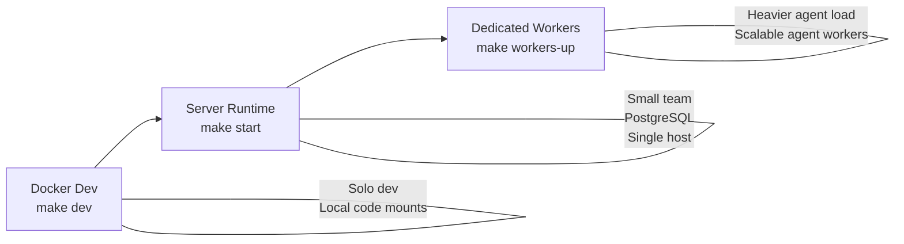
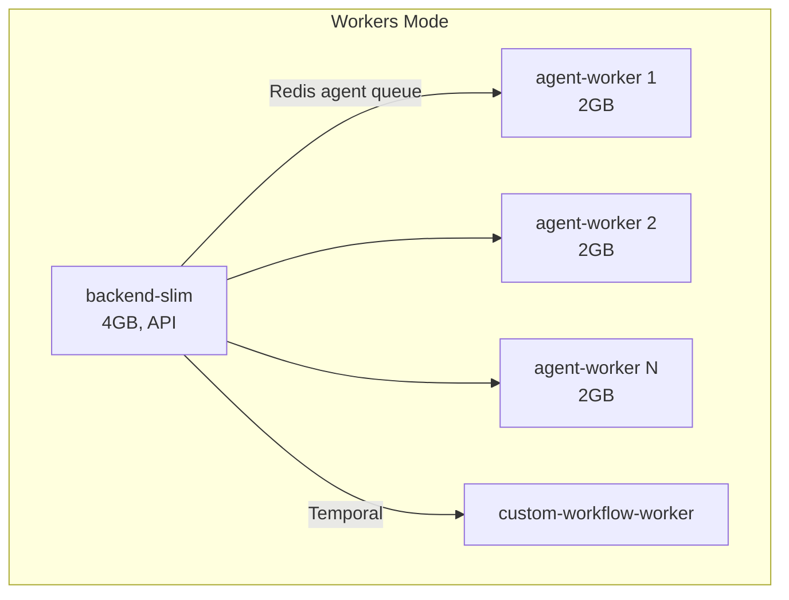
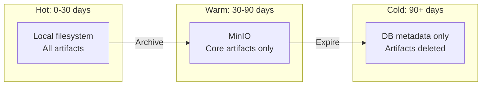

# Infrastructure & Deployment Design

Veriloop dashboard overview running on the deployed platform.

Veriloop's supported deployment paths are both Docker Compose based: local
Docker development (`make dev`) and a server runtime behind your own reverse
proxy (`make start`). Both use `docker-compose.prod.yml`; `make dev` layers
`docker-compose.dev-override.yml` on top for local code mounts and hot reload.

## Deployment Spectrum

| Mode | Database | Execution | Scaling | Setup Effort |
|------|----------|-----------|---------|-------------|
| Docker dev | PostgreSQL | Single backend container | None | `make dev` |
| Server runtime | PostgreSQL | Single backend container | Manual | `make start` |
| Dedicated workers | PostgreSQL | `backend-slim` API + `agent-worker` containers | Manual (`make workers-scale N=...`) | `make workers-up` |

## Why Docker Compose for Teams

Docker Compose strikes the right balance between reproducibility and simplicity for teams of 1-20 users. A single `docker-compose.prod.yml` file defines all services, volumes, networks, and health checks. There is no cluster to manage, no ingress controller to configure, and no persistent volume claims to provision.

The trade-off is limited scaling. Docker Compose can scale agent workers horizontally on a single host (`make workers-scale N=...`), but cannot distribute work across multiple machines. For most teams, a single 8-core server with 32GB RAM handles 4-8 concurrent browser operations comfortably.

### Standard vs Workers Mode

Two Docker Compose profiles exist because browser automation has extreme resource requirements compared to API serving.

**Standard mode** (`standard` profile, used by `make dev` and `make start`) bundles everything into a single 24GB backend container: the API server, Playwright browsers, a VNC server for live viewing, and the agent, autonomous mission, and custom workflow worker processes under supervisord. This is simple to operate but wastes resources when the API is idle and limits scaling to the single container.

**Workers mode** (`workers` profile, used by `make workers-up`) separates the API (`backend-slim`, 4GB, no VNC) from agent execution (`agent-worker`, 2GB each) and Temporal workflow execution (`custom-workflow-worker`). This lets you scale agent capacity independently:

Workers mode is better for heavier production load because:
- A crashed agent worker does not bring down the API
- You can scale agent workers up during business hours and down at night
- The slim API container needs far less memory (4GB vs 24GB)
- Isolation prevents memory leaks in long-running agent sessions from affecting the API

The cost is added complexity: Redis becomes required for task distribution, and you must manage multiple container types.

## VNC: Live Browser Viewing

The standard Docker mode includes a VNC server that streams the browser display to the dashboard via WebSocket. This is valuable during debugging but imposes constraints:

- Requires a virtual framebuffer (Xvfb) and window manager (Fluxbox)
- Limits parallel execution to 1 browser (all browsers share the same display)
- Adds 4 supervisord processes (Xvfb, Fluxbox, x11vnc, websockify)
- Only available to superusers (security consideration)

Workers mode does not include VNC, trading live viewing for scalability. In server deployments, your reverse proxy forwards `/websockify` to backend port 6080 so the dashboard can reach the VNC stream from the same origin.

## Backup and Archival Strategy

The tiered storage system balances disk cost against data availability:

**Why three tiers?** Test run artifacts (screenshots, traces, HTML reports) consume significant disk space. A single run can produce 50-100MB of trace data. Over months, this adds up to hundreds of gigabytes. The tiered approach keeps recent data instantly accessible while automatically moving older data to cheaper storage.

**Hot tier** (0-30 days) keeps everything on the local filesystem for fast access. This is where active debugging happens.

**Warm tier** (30-90 days) moves only core artifacts (plan.json, validation.json, report.html) to MinIO. Screenshots and traces are deleted because they are rarely needed after the first month.

**Cold tier** (90+ days) deletes all artifacts, preserving only database metadata. You can still query historical pass/fail rates, but cannot view screenshots from old runs.

Configuration via `ARCHIVE_HOT_DAYS` (default: 30) and `ARCHIVE_TOTAL_DAYS` (default: 90) lets teams tune retention to their compliance requirements.

## Database Choice

The platform supports both SQLite and PostgreSQL through SQLModel/SQLAlchemy:

- **SQLite** for native CLI development: Zero configuration, single-file database, sufficient for a solo developer. No migrations needed (auto-created by `init_db()`).
- **PostgreSQL** for the Docker stacks: Concurrent write safety, proper ACID transactions, Alembic migrations for schema evolution.

!!! warning "Migration Boundary"
    SQLite uses auto-migration via `init_db()`. PostgreSQL uses Alembic (`make db-upgrade`). Existing databases created before Alembic was introduced need `make db-stamp R=001` to mark the current schema, then future migrations apply cleanly.

## Redis: Queue and Rate Limiter

Redis serves multiple roles in production:
- **Agent task queue**: Decouples the API from long-running agent tasks executed by agent workers
- **K6 queue**: Distributes load tests to K6 worker containers when they are running
- **Rate limiting**: Distributed counters for login and API throttling
- **Load test lock**: Exclusive lock preventing browser ops during K6 runs

The system falls back gracefully when Redis is unavailable: agent tasks run directly in the backend, and rate limiting uses process-local storage. This means development works without Redis, but production benefits from it for distributed coordination.

## Resource Sizing

### Docker Compose (Standard)

| Resource | Minimum | Recommended |
|----------|---------|-------------|
| RAM | 16GB | 32GB+ |
| CPU | 4 cores | 8+ cores |
| Disk | 50GB | 200GB+ |

### Docker Compose (Workers)

| Component | RAM | Count |
|-----------|-----|-------|
| backend-slim | 4GB | 1 |
| agent-worker | 2GB each | 2-8 |
| PostgreSQL | 4GB | 1 |
| Redis + MinIO | 1.5GB | 1 each |

!!! tip "Shared Memory for Chromium"
    Browser containers require at least 1GB of `/dev/shm` (shared memory). Without it, Chromium crashes with `SIGBUS` errors. Docker Compose sets `shm_size: 2gb` for the standard backend container.

## Related

- [System Overview](./system-overview.md) -- How infrastructure supports the component architecture
- [Queue and Worker Architecture](./queue-worker-architecture.md) -- Agent, K6, and Temporal workers
- [Security Model](./security-model.md) -- Network isolation and container hardening
- [Deployment Guide](../guides/deployment.md) -- Step-by-step deployment instructions
- [Environment Variables](../reference/environment-variables.md) -- Configuration reference
- [Disaster Recovery](../guides/disaster-recovery.md) -- Backup and restore procedures
