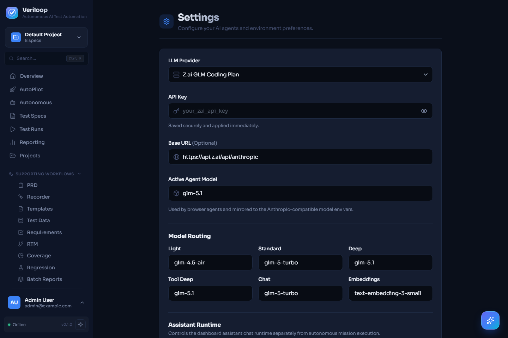

# How to Deploy Veriloop



<p class="caption">Settings dashboard used to verify deployment configuration.</p>


Choose a deployment mode and configure it for your environment, from local development to a server behind your own reverse proxy.

## Prerequisites

- Docker and Docker Compose v2
- An `.env.prod` file with required secrets (`make prod-env-bootstrap` creates one from `.env.prod.example`)
- For server deployments: your own DNS, TLS termination, and reverse proxy (for example nginx)

## Deployment Modes Overview

| Mode | Use Case | Command | Scaling |
|------|----------|---------|---------|
| Docker dev | Main local full-stack development | `make dev` | Single instance |
| Server runtime | Your own DNS/TLS/reverse proxy in front of Compose | `make start` | Single instance |
| Dedicated workers | Agent and workflow execution in separate containers | `make workers-up` | N agent-worker containers |
| Repo-managed nginx | Legacy single-host path, guarded | `VERILOOP_ENABLE_REPO_NGINX=1 make prod-up` | Single instance |

Both supported paths use `docker-compose.prod.yml`. `make dev` adds `docker-compose.dev-override.yml` for local code mounts and frontend hot reload; `make start` runs the production images as-is.

## Docker Development

The main development mode runs the production-shaped Compose stack with local
code mounts. The frontend runs in Next.js development mode with hot reload.
Backend source is mounted, but backend reload is disabled in Docker to avoid
bind-mount import races.

```bash
make check-env
make dev      # Start full Docker stack
```

`make dev` starts:

1. PostgreSQL, Redis, MinIO, Temporal, backend, frontend, and VNC/websockify
2. Local `orchestrator/` and `web/src/` mounts
3. Frontend hot reload through `npm run dev`
4. No repo-managed nginx and no ZAP unless `make zap-up` is run

Services:

| Service | URL |
|---------|-----|
| Dashboard | http://localhost:3000 |
| Backend API | http://localhost:8001 |
| API Docs (Swagger) | http://localhost:8001/docs |

```bash
make stop     # Stop all services
make logs     # Tail backend + frontend logs
```

## Legacy Compose Path

`docker-compose.yml` is retained for reference and local experiments, but it is
not a supported runtime path (`make docker-up` exits with a pointer to the
supported targets).

```bash
make dev      # Supported local full-stack Docker path
make start    # Supported server runtime path
```

## Server Deployment

### Create the Production Environment File

```bash
make prod-env-bootstrap
```

This creates `.env.prod` from `.env.prod.example` (if missing) and generates
private values such as the database, MinIO, and JWT secrets. Edit `.env.prod`
to set your AI provider credentials and security settings:

```bash
# Required secrets
VERILOOP_LLM_API_KEY=your-production-token
JWT_SECRET_KEY=$(openssl rand -hex 32)
POSTGRES_PASSWORD=$(openssl rand -hex 16)
MINIO_ROOT_PASSWORD=$(openssl rand -hex 16)

# Security settings
REQUIRE_AUTH=true
ALLOW_REGISTRATION=false

# Optional: initial admin user
INITIAL_ADMIN_EMAIL=admin@yourcompany.com
INITIAL_ADMIN_PASSWORD=your-secure-password
```

Validate the file before startup:

```bash
make check-env
```

### Server Runtime

Runs the external-nginx app runtime: a single backend container with Playwright
browsers and VNC/websockify, plus frontend, database, queue, storage, and Temporal.
Your reverse proxy forwards `/` to frontend port 3000 and `/websockify` to
backend port 6080.

```bash
make start
make deploy-check   # Verify external-nginx runtime readiness
```

Services started:

| Service | URL | Description |
|---------|-----|-------------|
| Dashboard | http://localhost:3000 | Next.js frontend |
| API | http://localhost:8001 | FastAPI backend |
| VNC View | http://localhost:6080 | Live browser (noVNC) |
| MinIO Console | http://localhost:9001 | Object storage admin |
| Temporal | localhost:7233 | Durable workflow engine for autonomous missions |
| Temporal UI | http://localhost:8233 | Temporal workflow inspection UI |

The backend container uses **supervisord** to manage:
- Xvfb (virtual display at `:99`, 1920x1080x24)
- Fluxbox (window manager)
- x11vnc (VNC server)
- websockify (WebSocket bridge on port 6080)
- uvicorn (API server on port 8001)
- agent worker, autonomous mission worker, and custom workflow worker processes

Resource allocation: 24 GB memory limit, 8 CPUs, 2 GB shared memory.

Keep direct ports `3000`, `8001`, and `6080` private to the server or a trusted
network; only the reverse proxy should be public.

### Workers Mode (Dedicated Worker Containers)

Moves agent and workflow execution into dedicated containers. The API runs as
`backend-slim` (no local browsers, 4 GB memory instead of 24 GB). Agent workers
consume tasks from the Redis agent queue; the custom workflow worker polls
Temporal for custom workflows and agent runs.

```bash
make workers-up              # Start with default 2 agent workers
make workers-scale N=4       # Scale agent-worker to 4 containers
make workers-status          # View worker status and resource usage
make workers-logs            # Tail agent-worker, custom-workflow-worker, backend-slim logs
make workers-down            # Stop everything
```

Architecture in workers mode:

```
Frontend (port 3000)
    |
Backend-Slim (port 8001, no browsers)
    |                          \
Redis (agent queue)           Temporal
    |                            |
+----+----+----+          custom-workflow-worker
| A1 | A2 | AN |   <-- agent-worker (scalable)
+----+----+----+
```

Each agent-worker container has a 2 GB memory limit and 2 CPUs.

### Production Commands Reference

```bash
make start                # Start server external-nginx runtime
make dev                  # Start local full-stack Docker development
make prod-down            # Stop services (30s graceful timeout)
make prod-down-safe       # Backup first, then stop
make prod-restart         # Restart backend + frontend (picks up mounted code changes)
make prod-logs            # Tail backend, frontend, and worker logs
make prod-build           # Rebuild images (with cache)
make prod-build-no-cache  # Rebuild images (fresh, no cache)
make prod-status          # Service status + health check
```

### Upgrading Production

1. Back up first: `make backup-full`
2. Update your checkout to the new version (for example `git pull` or `git checkout <tag>`)
3. Rebuild and restart: `make prod-build && make restart`
4. Run post-deploy checks: `make deploy-check` and `make health-check`

Apply pending database migrations with `make db-upgrade` if they are not applied
automatically at backend startup (see
[Database Migration Architecture](../explanation/database-migration-architecture.md)).

Rollback if something goes wrong:

```bash
make db-downgrade              # Roll back migration
git checkout <previous-tag>    # Revert code
make prod-build && make start  # Rebuild and restart external-nginx runtime
```

## Backup and Recovery

### Running Backups

```bash
make backup              # Database only
make backup-full         # DB + specs + tests + PRDs + ChromaDB
make backup-status       # View backup history
```

Backups are stored in the `backup_data` Docker volume and optionally synced to MinIO.

### Restoring from Backup

```bash
make restore-list                    # List available backups
make restore TS=20260208_143022      # Restore from timestamp
make restore-from-minio TS=...      # Restore from MinIO
```

### Scheduled Backups

The `backup-scheduler` service runs in production and executes:
- **2 AM daily**: Full backup with MinIO sync
- **3 AM daily**: Artifact archival (hot/warm/cold retention tiers)

### Artifact Retention

| Tier | Age | Storage | Contents |
|------|-----|---------|----------|
| Hot | 0-30 days | Local (`runs/`) | All artifacts |
| Warm | 30-90 days | MinIO | Core artifacts only (plan.json, validation.json, report.html) |
| Cold | 90+ days | Deleted | Database metadata only |

```bash
make archival             # Run archival now
make archival-dry-run     # Preview what would be archived
make storage-health       # Check storage health
```

## Database Migrations

When deploying model changes to PostgreSQL:

```bash
make db-migrate M="describe your change"   # Generate migration
make db-upgrade                              # Apply pending migrations
make db-downgrade                            # Roll back one step
make db-history                              # View migration history
make db-stamp R=001                          # Stamp existing DB at revision
```

Migrations are stored in `orchestrator/migrations/versions/` and managed by Alembic.

## Reverse Proxy

Server deployments use your own DNS/TLS/reverse proxy in front of `make start`;
the repo-managed nginx profile is not part of that path. Your proxy forwards `/`
to frontend port 3000 and `/websockify` to backend port 6080. Leave
`VERILOOP_PUBLIC_API_URL` and `NEXT_PUBLIC_API_URL` blank so the browser uses
same-origin API routing, and set `VNC_PUBLIC_WS_URL` to your public
`/websockify` URL.

The guarded legacy repo-managed nginx target (configuration in `nginx/nginx.conf`)
is available only when explicitly requested:

```bash
VERILOOP_ENABLE_REPO_NGINX=1 make prod-up
```

## Health Checks

All production services include health checks:

```bash
make health-check    # Hit all health endpoints
```

Available health endpoints:

| Endpoint | Purpose |
|----------|---------|
| `GET /health` | Backend API status |
| `GET /health/storage` | Local + MinIO storage status |
| `GET /health/backup` | Last backup status |
| `GET /health/alerts` | Active alerts |

## Maintenance Commands

```bash
make docker-prune     # Remove dangling images, stopped containers, build cache
make volume-sizes     # Show Docker volume sizes
make db-vacuum        # Run VACUUM ANALYZE on PostgreSQL
```

## Verification

After deployment, confirm everything works:

1. `make health-check` passes all endpoints
2. Dashboard loads at the configured URL
3. Login works with admin credentials (if auth is enabled)
4. A test spec runs and completes through the pipeline
5. Backups are being created (check `make backup-status`)

## Related Guides

- [Choosing a Setup Path](./setup-options.md) -- compare local and server setups
- [Disaster Recovery](./disaster-recovery.md) -- backup and recovery procedures
- [Artifact Storage Lifecycle](../explanation/artifact-storage-lifecycle.md) -- hot/warm/cold artifact retention
- [Database Migration Architecture](../explanation/database-migration-architecture.md) -- Alembic and startup migration behavior
- [Authentication](./authentication.md) -- enable auth and manage users
- [Troubleshooting](./troubleshooting.md) -- diagnose deployment issues
