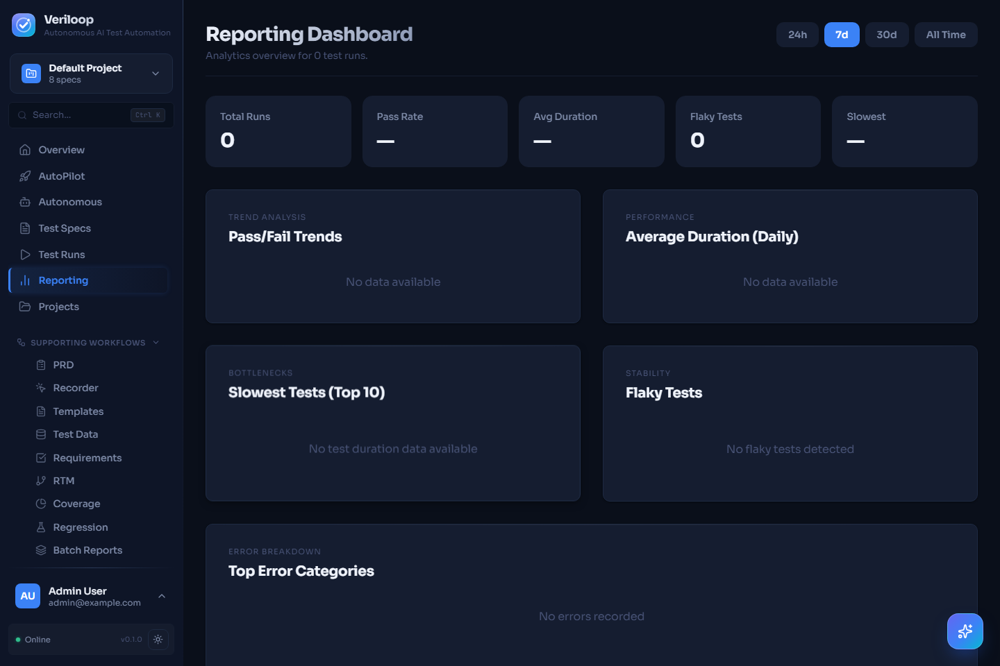

# Documentation Maintenance



<p class="caption">Veriloop dashboard overview used in documentation visual maintenance.</p>


How to keep Veriloop documentation accurate as features, APIs, and dashboard pages change.

## Prerequisites

- Local checkout of the repository
- Python environment with docs dependencies installed
- Basic familiarity with the feature you changed

```bash
pip install -r requirements-docs.txt
```

## Step 1: Choose the Right Page Type

Use the Diataxis structure already in `docs/`:

| Change type | Update this area | Purpose |
|-------------|------------------|---------|
| New user workflow | `docs/tutorials/` | Teach a first successful path |
| Operational task | `docs/guides/` | Help users solve a specific problem |
| API, CLI, env var, schema, or UI surface | `docs/reference/` | Record exact options and fields |
| Architecture or design rationale | `docs/explanation/` | Explain why the system works this way |
| Development workflow | `docs/guides/` (Development section) | Keep maintainers aligned on how to change the system |

Do not mix page types. If a page starts becoming both a tutorial and a reference, split the content and link between the pages.

## Step 2: Check the Documentation Impact

Before opening a PR, check whether your code change affects any of these surfaces:

| Code changed | Documentation to check |
|--------------|------------------------|
| FastAPI route in `orchestrator/api/` | `docs/reference/api-endpoints.md`, related guide |
| Request or response model | API reference, dashboard reference, examples |
| Environment variable | `docs/reference/environment-variables.md`, setup tutorials |
| CLI flag or command | `docs/reference/cli.md`, getting started tutorial |
| Makefile target | `docs/reference/makefile.md` |
| Database model or migration | `docs/reference/database-schema.md`, architecture explanation |
| Dashboard route or workflow | `docs/reference/web-dashboard.md`, related tutorial or guide |
| UI screenshot or GIF | `docs/assets/ui/visual-assets.manifest.json`, related page |
| Pipeline behavior | `docs/guides/pipeline-modes.md`, `docs/explanation/pipeline-architecture.md` |
| Memory behavior | `docs/explanation/memory-system.md`, `docs/reference/api-endpoints.md` |
| Deployment behavior | `docs/guides/deployment.md`, `docs/guides/setup-options.md`, `docs/explanation/infrastructure.md` |

## Step 3: Keep References Source-Aligned

Use source files as the authority:

```bash
rg -n "^@router\\.(get|post|put|patch|delete)|^@app\\.(get|post|put|patch|delete)|add_api_route" orchestrator/api
rg -n "os\\.getenv|process\\.env|Field\\(.*env" orchestrator web --glob '!node_modules/**'
rg -n "add_argument|click\\.option|typer\\.Option" orchestrator
```

When updating reference docs, prefer compact tables over prose. Include source file names when the page already uses them.

Run the automated drift check after reference changes. It verifies environment variables, CLI flags, selected public API routes, `localhost:8001` API examples, dashboard pages, MkDocs navigation coverage, local documentation image assets, UI visual coverage, and common stale setup strings before running the strict docs build:

```bash
make docs-check
```

## Step 4: Keep UI Visuals Current

Every published docs page must render at least one UI screenshot or GIF from `docs/assets/ui/`. Use screenshots for stable pages and short GIFs for multi-step workflows. Do not use terminal screenshots.

When a dashboard workflow changes, start the dashboard, capture the affected page at the manifest's default viewport (1440x960), and save the PNG or GIF under `docs/assets/ui/`. Then update the matching entry (`id`, `route`, `path`, `alt`) in `docs/assets/ui/visual-assets.manifest.json` and run the visual check on its own:

```bash
python scripts/check_docs_drift.py --visual-only
```

The visual check verifies that each published page has a visible local UI visual with alt text and that manifest assets exist, are non-empty, and are at least 320x180 pixels. `make docs-check` runs the same check together with the other drift checks.

## Step 5: Update Navigation

If you add a new page, add it to `mkdocs.yml` under the correct section. Every public docs page should be reachable from the navigation or from a directly related page.

For hidden maintainer notes, use `docs/.style-guide.md` or another excluded file and document why it is excluded.

## Step 6: Build the Docs

Run the docs build before submitting:

```bash
make docs-check
```

If MkDocs is not available, install the docs dependencies:

```bash
pip install -r requirements-docs.txt
make docs-check
```

Fix warnings before merging. Broken links, duplicate headings, missing nav entries, invalid Mermaid blocks, missing env vars, missing CLI flags, and stale setup snippets tend to become user-facing gaps quickly.

## Step 7: Review for Drift

Use this checklist for every docs PR:

- The page has one clear purpose and one audience.
- Commands are copy-pasteable from the repository root unless stated otherwise.
- Links are relative for internal docs.
- API paths, local `localhost:8001` curl examples, env vars, dashboard routes, CLI flags, nav entries, and referenced local assets match the code and repository.
- Each published docs page renders a UI screenshot or GIF from `docs/assets/ui/`.
- Examples avoid real credentials and use placeholders.
- New docs are included in `mkdocs.yml`.
- `make docs-check` passes.

## Related

- [Extending the System](extending.md)
- [API Endpoints](../reference/api-endpoints.md)
- [Environment Variables](../reference/environment-variables.md)
- [Web Dashboard](../reference/web-dashboard.md)
