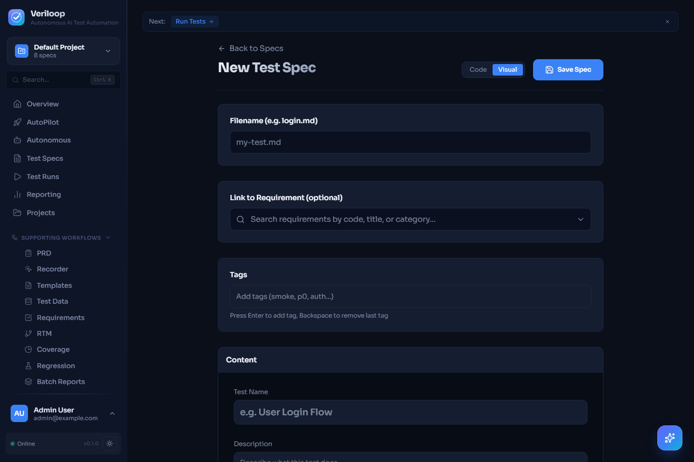

# Curated Examples



<p class="caption">Spec editor dashboard for writing and reviewing maintained examples.</p>

Use these maintained examples when evaluating Veriloop or checking how specs should be written. They are intentionally fewer than the full `specs/` tree so new readers land on examples that are current and useful. Paths are relative to the repository root.

| Example | Shows | Source |
|---------|-------|--------|
| Minimal hello-world spec | Smallest evaluator-friendly UI spec shape against a public demo site | `specs/examples/hello-world.md` |
| Checkout benchmark specs | Structured UI specs with base URL, objective, preconditions, steps, and expected outcomes | `specs/benchmark/` |
| API spec template | API test structure with a `{{API_TOKEN}}` credential placeholder instead of a hardcoded secret | `specs/templates/api-test-template.md` |
| Reusable spec template | Skeleton for a reusable template that other specs can include | `specs/templates/my-template.md` |
| Generated Playwright tests | Generated test files for review and CI execution (created when you run a spec) | `tests/generated/` |

## How To Use These Examples

For the fastest local check, start the stack with `make dev` and run the hello-world spec from the dashboard, or run it from the CLI:

```bash
python orchestrator/cli.py specs/examples/hello-world.md
```

The generated Playwright test is written under `tests/generated/` and the run artifacts under `runs/`. For production-style coverage, review the checkout benchmark specs and the API template, then adapt the patterns to your own app and secrets.

Keep real credentials in `.env`, `.env.prod`, `.env.local`, `.secrets/`, or your shell environment. Specs should use placeholders instead of literal passwords or tokens.
